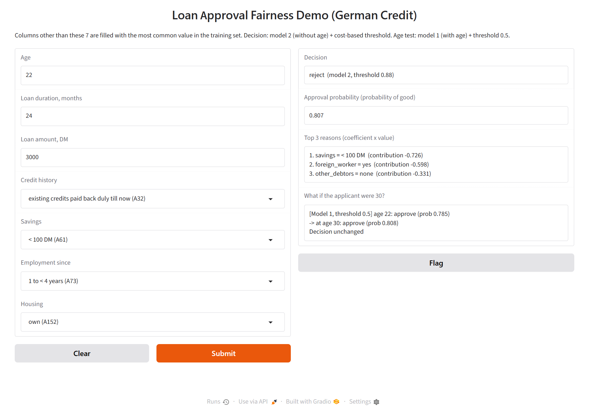
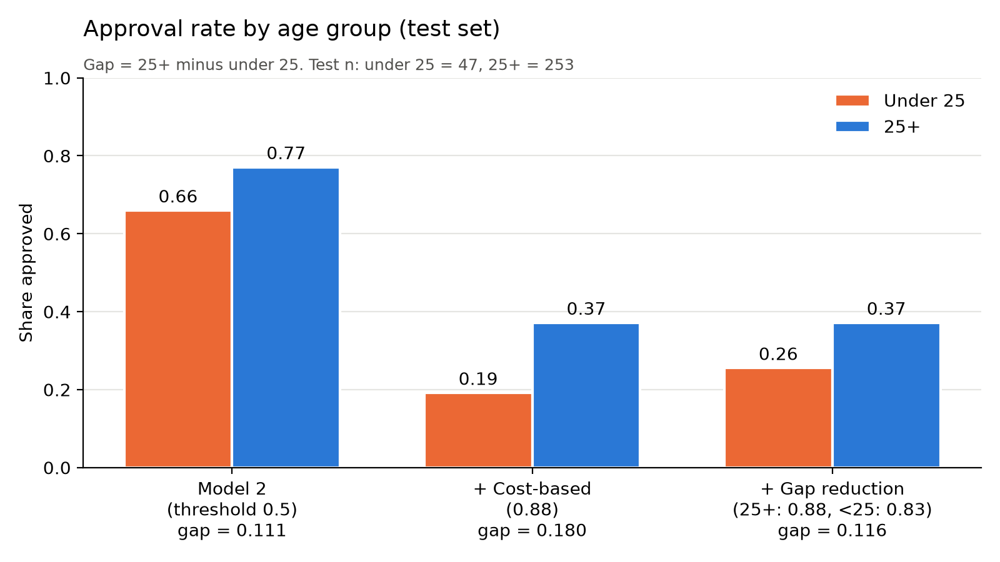

# Fairness Audit of a Loan Model (German Credit)

> **This project is a prototype and is not financial advice.**

Ryan Kim · Veritas AI Hackathon, Finance track (project 4.2.3) · November 15, 2026 · Notebook: [`audit.ipynb`](audit.ipynb)

**Short answer:** (1) Yes. Even among applicants who actually repaid, under-25s were approved less often (good-applicant gap 0.144). (2) Removing the age column does not close the gap (0.111 before and after), because other columns still reveal age (ROC AUC 0.836).

## The problem
Does a loan model treat applicants **under 25** worse than older applicants? If we **remove the age column**, does the gap go away?

## What we built
A step-by-step audit of the UCI German Credit data (1,000 applicants, 20 inputs), split 70/30 into train and test (stratified, `random_state=42`). We trained two logistic regression models, one **with** age and one **without**, and compared approval rates by age group on the test set.

## What we added
- **Age detector:** a check for proxies that predicts *under 25* from the other 19 columns.
- **Cost-based threshold:** approving a bad applicant costs 5 and rejecting a good one costs 1, the cost matrix from the dataset's own documentation. The threshold is chosen by 5-fold cross-validation on train only.
- **Gap reduction:** a separate under-25 threshold, set on train, that equalizes approval rates for good applicants.
- **Explanations:** the top 3 reasons behind each decision, plus an "age set to 30" counterfactual test.
- **Demo app (Gradio):** 7 inputs → decision, probability, reasons, age test.

## How it works
One-hot encoding + scaling → `LogisticRegression`. **The test set is never used for tuning.** To run it: `pip install -r requirements.txt`, then Run All. If UCI is down, Step 1 loads the copy in `data/`. To launch the app, set `RUN_APP = True` in the last cell.

## Results
**Test set:** 253 applicants are 25+ (184 good) and 47 are under 25 (26 good). Because the group is so small, one good under-25 applicant moves its approval rate by about 4 points.

1. **Gap:** model 1 (with age) approves 77.1% of 25+ applicants and 66.0% of under-25 applicants. That is a gap of 0.111; the actual gap in repayment rates is 0.174.
2. **Removing age:** model 2 has the same gap of 0.111, and only 4 of 300 predictions changed. In model 1, setting age to 30 flips 0 of 47 decisions. The age comes back through proxies:

| Proxy input | Age coef (+ = younger) | Model 2 approval coef |
|---|---|---|
| male: divorced/separated (A91) | −0.996 | −0.080 |
| job: management / self-employed (A174) | −0.916 | 0.232 |
| employed ≥ 7 years (A75) | −0.908 | −0.048 |
| housing: rent (A151) | 0.848 | **−0.437** |
| purpose: business (A49) | −0.680 | 0.002 |

3. **Trade-offs (model 2, test set)**

| | Default (0.5) | Cost threshold (0.88) | Gap reduction (0.88 / <25: 0.83) |
|---|---|---|---|
| Accuracy | 0.747 | 0.583 | 0.593 |
| Total cost | 260 | 161 | 158 |
| Approval: under 25 / 25+ | 0.660 / 0.771 | 0.191 / 0.372 | 0.255 / 0.372 |
| Approval gap | 0.111 | 0.180 | 0.116 |
| Good-applicant approval gap | 0.144 | 0.160 | **0.044** |

Accuracy drops because a bad loan costs 5 times more than a missed good one, so the bank should minimize cost. The cost threshold cuts cost but widens the gap. Gap reduction closes most of it at about the same cost, but it uses age directly.

4. **Mistakes:** at the cost threshold, 18 of 26 good under-25 applicants were rejected.
   - Applicant 480 (age 23) scored 0.877, just under 0.88. Their top reasons were savings < 100 DM and *foreign worker = yes*.
   - Applicant 391 (age 19) had savings ≥ 1000 DM and a 983 DM, 12-month loan. They scored 0.866 and were still rejected.

**US lending rules** (our reading as students, not legal advice):
- ECOA bans age discrimination, but Regulation B lets a sound scoring system use age as long as applicants 62+ get no negative value. So model 1 is not automatically illegal.
- Regulation B now says the "effects test" (disparate impact) does not apply. That means the gap left through proxies is a fairness problem the current rule may not cover.
- Gap reduction gives everyone 25+, including people 62+, a stricter cut-off. The commentary requires 62+ to be treated "at least as favorably", so gap reduction likely conflicts with it.
- Lenders must give rejected applicants specific reasons, which our explanations provide. But *foreign worker* is close to national origin, which is also a prohibited basis.

**Limitations:** the data is from Germany in 1994; only 47 test applicants are under 25; we used one split (so no error bars) and one model type.

## What we'd do next
- Repeat the analysis on larger, more recent data, with several random splits.
- Find fairness fixes that don't use age at decision time.
- Test the 62+ group.
- Audit `foreign_worker`.
- Check data quality (for example, two 24-year-olds with 7+ years of employment).

## Sources
- Hofmann, H. (1994). *Statlog (German Credit Data)* [Dataset]. UCI Machine Learning Repository. https://doi.org/10.24432/C5NC77 (CC BY 4.0)
- ECOA, 15 U.S.C. § 1691(a); Regulation B, 12 CFR 1002.2(o), 1002.6, 1002.9; CFPB Circular 2022-03 (May 26, 2022). https://www.consumerfinance.gov/rules-policy/regulations/1002/
- pandas, scikit-learn, matplotlib, ucimlrepo, Gradio (versions in `requirements.txt`)
- Claude Code (AI assistant): I used it to draft the code and the cell-by-cell explanations one step at a time. I ran and checked every cell, and I wrote the write-up and conclusions myself.
